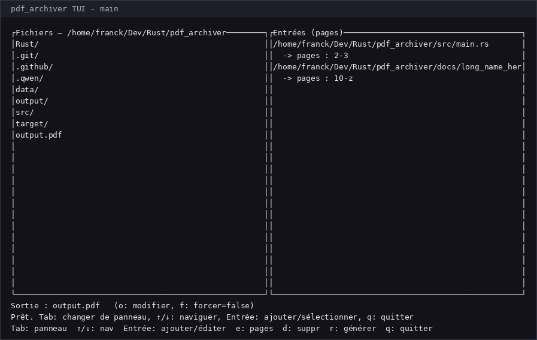
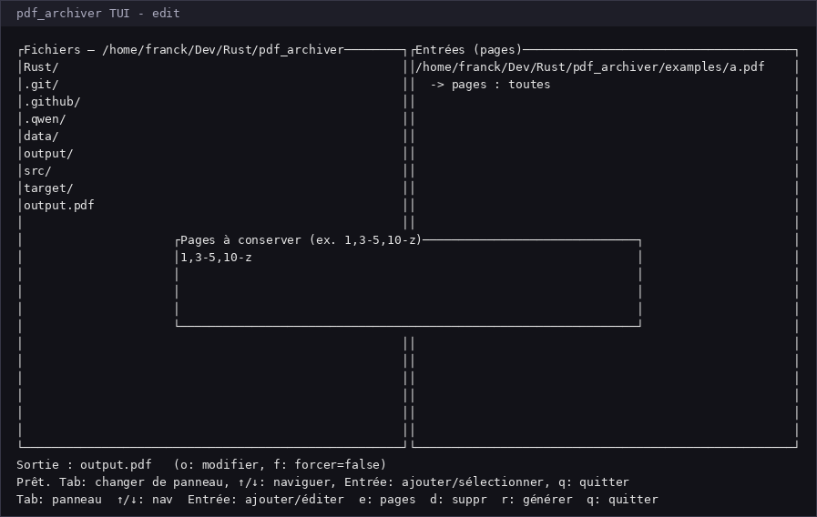

# pdf_archiver

`pdf_archiver` est un outil Rust pour extraire, combiner et réorganiser des pages de plusieurs fichiers PDF dans un nouveau document.

Il dispose d’un mode ligne de commande et d’une interface TUI interactive.

## Fonctionnalités

- Combiner des pages de plusieurs PDF.
- Sélectionner des pages individuelles, des plages et des pages répétées.
- Utiliser `z`, `last` ou `end` pour désigner la dernière page.
- Supporter les plages ouvertes : `10-` (jusqu’à la fin), `-3` (depuis le début).
- Répéter une entrée ou une page pour la garder plusieurs fois.
- Interface TUI pour parcourir les fichiers, composer les entrées et générer le PDF.
- Génération croisée GitHub Actions d’un binaire Windows MSVC lors d’un tag.

## Installation locale

Avec Rust installé :

```bash
cargo build --release
```

Le binaire sera disponible ici :

```text
target/release/pdf_archiver
```

Sur Windows, via la release GitHub :

```text
pdf_archiver.exe
```

## Utilisation en ligne de commande

```bash
pdf_archiver input1.pdf[:PAGES] [input2.pdf[:PAGES] ...] -o output.pdf [-y]
```

Exemples :

```bash
# Pages 2 à 3 de a.pdf, puis pages 1 et 2 de b.pdf
pdf_archiver a.pdf:2-3 b.pdf:1,2 -o out.pdf -y

# À partir de la page 10 jusqu'à la fin
pdf_archiver doc.pdf:10-z -o out.pdf

# Plage ouverte et dernière page
pdf_archiver doc.pdf:10- doc.pdf:z -o out.pdf
```

Options :

```text
INPUT[:PAGES]    Fichier PDF et sélection de pages
-o, --output     Chemin du PDF de sortie
-y, --yes        Écrase le fichier existant sans confirmation
--tui            Lance l’interface interactive
```

## Sélection de pages

Le sélecteur supporte :

- `1` : une seule page ;
- `1,3,7` : plusieurs pages ;
- `1-5` : une plage ;
- `5-3` : plage inversée, normalisée en `3-5` ;
- `10-z` : de la page 10 à la dernière page ;
- `10-` : de la page 10 à la fin ;
- `-3` : de la première page à la page 3 ;
- `z`, `last`, `end`, `$` : dernière page.

Les pages sont 1-based. Le symbole de fin représente le nombre total de pages du document concerné.

## TUI interactive

Sans arguments ou avec `--tui`, l’application lance son interface interactive :

```bash
pdf_archiver
# ou
pdf_archiver --tui
```

Raccourcis principaux :

- `Tab` : changer de panneau ;
- `↑` / `↓` : naviguer ;
- `Entrée` : ajouter un PDF ou éditer une entrée ;
- `e` : modifier la sélection de pages ;
- `d` : supprimer une entrée ;
- `o` : modifier le chemin de sortie ;
- `f` : basculer l’écrasement forcé ;
- `r` : générer le PDF ;
- `q` : quitter.

Exemples d’interface :





## Tests

```bash
cargo test
```

## Build release

```bash
cargo build --release
```

### Cross-compilation Windows depuis Linux

```bash
rustup target add x86_64-pc-windows-gnu
sudo apt install mingw-w64
cargo build --release --target x86_64-pc-windows-gnu
```

## GitHub Actions / Release

Le workflow `.github/workflows/release.yml` :

- se déclenche sur les tags `v*` ou manuellement ;
- compile sur `windows-latest` ;
- utilise la cible `x86_64-pc-windows-msvc` ;
- exécute `cargo fmt --check`, `cargo test --release`, `cargo build --release` ;
- publie un artifact Windows ;
- crée une Release GitHub avec `pdf_archiver.exe` et son hash SHA256.

Créer une release :

```bash
git tag v0.1.0
git push origin v0.1.0
```

## Notes

- Les entrées sont traitées dans l’ordre des arguments.
- Répéter un fichier ou une page conserve l’ordre et les doublons.
- L’application de sortie par défaut en TUI est `output.pdf`.
